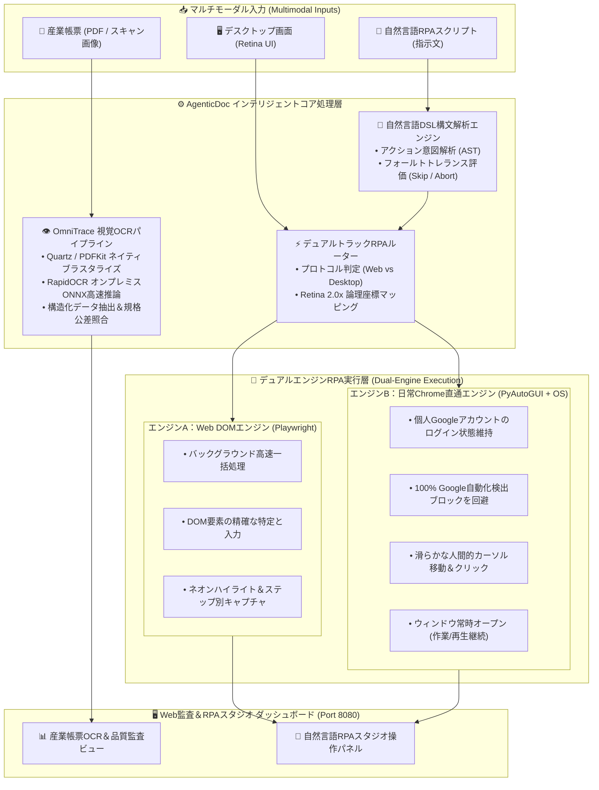

# AgenticDoc RPA (`agentic-doc-rpa`)

> **インテリジェント文書エージェント＆デュアルエンジン視覚RPAシステム**  
> *Autonomous Document Intelligence & Dual-Engine Vision RPA Platform*

[ [English](./README.md) ] | [ [繁體中文 (台灣)](./README.zh-TW.md) ] | [ 日本語 ] | [ [한국어](./README.ko.md) ]

[](https://www.python.org/)
[](LICENSE)
[]()
[]()

---

## 📖 プロジェクト概要 (Overview)

**AgenticDoc RPA** は、企業向けビジネス帳票のライフサイクル監査、サプライチェーン追跡、および最新のデスクトップ/Web自動化のために設計された**インテリジェント文書エージェント＆デュアルエンジン視覚RPAシステム**です。

本システムは **100% オンプレミス（完全ローカル）** で動作可能であり、機密性の高い製造情報や財務帳票が外部パブリッククラウドに流出するリスクを完全に排除します。システムは「多言語文書の視覚監査」と「次世代デュアルトラックRPA」の2つの主要な柱を統合しています：
1. **帳票監査とサプライチェーン追跡**：複雑な産業帳票（発注書PO、検査成績書CoA、作業指示書WO、図面DWG、不具合分析書FA）を高速に読み取り、規格公差を照合。
2. **自律型デュアルエンジン視覚RPA**：直感的な自然言語スクリプトおよび画面OCR座標定位を活用し、Google等のボット検出ブロックを受けずにWebおよび日常利用のChromeブラウザを自動操作。

---

## 🌟 コア機能：帳票監査＋デュアルエンジンRPA アーキテクチャ



---

## 🤖 注目機能：デュアルエンジンRPAプラットフォーム解説

従来のRPAツールは、固定座標のズレやヘッドレスブラウザのボット検出によるブロックに悩まされがちでした。AgenticDoc RPAは異なる運用ニーズに対応する**デュアルエンジン設計**を採用しています：

### 1. エンジンA：Web DOMコアエンジン (`playwright_dom`)
* **用途**：標準的なWebシステム、社内ポータルへのバッチ入力、定期バックグラウンド処理。
* **主要機能**：
  * **DOMセレクター制御**：CSS Selector、XPath、テキスト指定による強固なUI特定。
  * **視覚的デモモード**：Slow-mo（スローモーション）実行およびネオン枠ハイライト。
  * **監査証跡の自動生成**：各実行ステップでBase64画像ログを生成。

### 2. エンジンB：日常Chromeダイレクトエンジン (`quartz_real_chrome`)
* **用途**：ユーザーの個人Googleアカウント（YouTube、個人Workspace等）での作業や、厳格なボット対策が施されたWebサービス。
* **主要機能**：
  * **Googleボット検出を100%回避**：日常使用している本物のGoogle Chromeインスタンスを直接起動。既存のログイン状態やCookieを継承し、*"This browser or app may not be secure"* 警告を完全回避。
  * **ウィンドウ常時維持 (Keep-Open)**：自動化完了後もブラウザを強制終了せず維持（YouTube音楽を聴きながら作業可能）。
  * **人間的なカーソル軌跡**：`pyautogui` と `easeInOutQuad` イージング曲線により、人間の手動操作に近い自然な速度と軌道で移動・クリック。

### 3. 画面視覚OCRロケーター (`ScreenOCRLocator`)
* RapidOCR を用いてデスクトップ画面全体のテキストをリアルタイム走査。
* macOS Retina ディスプレイの縮尺倍率（2.0x 論理座標マッピング）を自動補正し、物理ピクセルを正確なOSクリック座標へ変換。
* 固定ピクセルではなく「テキスト内容」に基づいてボタンを動的に特定するため、画面サイズやレイアウトの変化にも柔軟に対応。

### 4. 自然言語RPAスクリプト (`NLScriptParser`)
プログラミング知識のない担当者でも、自然言語の平易な指示文で自動化フローを構築できます：
```text
前往網址: https://www.youtube.com
在「搜尋框」輸入: 作業用BGM
按下鍵盤: Enter
如果失敗: 跳過
點擊包含文字: 作業
等待 2 秒
截圖說明: BGM再生開始
```
* **障害復旧ポリシー**：`如果失敗: 跳過 (skip)` および `如果失敗: 中斷 (abort)` に対応。

---

## 👁️ OmniTrace 産業帳票視覚監査機能

* **ネイティブ高解像度レンダリング**：macOSネイティブの Quartz (PDFKit) サブシステムを活用し、Poppler等の外部依存なしで150+ DPIの高解像度ラスタライズを実行。
* **サプライチェーントレーサビリティ**：製造ライフサイクル（発注PO ➔ 受入IQC ➔ 指示WO ➔ 成績CoA ➔ 出荷SO ➔ 不具合FA 8D）を通じてロット番号と数値を照合。
* **スペック公差自動判定**：ガラス転移温度 $T_g$、厚み、引張強度などの重要パラメータを契約規格値と自動比較。

---

## 🛠️ 使用技術とAIスタック (Tech Stack & AI)

* **言語**：Python 3.11+, HTML5, CSS3, JavaScript (ES6+), Bash / Zsh
* **ディープラーニングOCR**：RapidOCR, ONNX Runtime
* **画像・幾何処理**：OpenCV, Pillow, Shapely
* **自動化エンジン**：Playwright, PyAutoGUI, macOS Accessibility API
* **オーケストレーション**：Temporal.io Durable Workflow, Apache Airflow

---

## 🚀 クイックスタート (Quick Start)

### 1. 動作環境
* macOS (Apple Silicon Mシリーズ推奨)
* Python 3.11+

### 2. 環境構築
```bash
# 仮想環境の作成と有効化
python3 -m venv .venv_rpa_ocr
source .venv_rpa_ocr/bin/activate

# 依存パッケージのインストール
pip install -r requirements_rpa_ocr.txt

# Playwrightブラウザのインストール
playwright install chromium
```

### 3. Web監査＆RPAスタジオの起動
```bash
.venv_rpa_ocr/bin/python src/web_audit/server.py --port 8080
```
ブラウザで **`http://127.0.0.1:8080`** にアクセス：
* **タブ1：帳票OCR＆品質監査**：PDF/画像をドラッグ＆ドロップし、構造化JSON抽出と公差照合を実行。
* **タブ2：自然言語RPAスタジオ**：シンプルな自然言語でブラウザ自動化フローを作成・実行。

---

## 📄 ライセンス宣言 (License)

本プロジェクトは **[MIT License](LICENSE)** に基づいて公開されています。

---

## 🔒 セキュリティとプライバシー保護

* **完全ローカル処理**：すべてのAI推論と帳票OCRはローカル環境で実行され、外部へのデータ送信は一切行われません。
* **認証情報の安全性**：日常利用しているChromeセッションを直接利用し、ユーザーのパスワードやセッショントークンを取得・保存・送信することは一切ありません。
