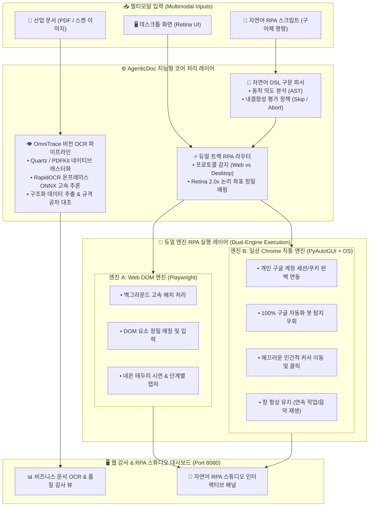

# AgenticDoc RPA (`agentic-doc-rpa`)

> **지능형 문서 에이전트 & 듀얼 엔진 비전 RPA 시스템**  
> *Autonomous Document Intelligence & Dual-Engine Vision RPA Platform*

[ [English](./README.md) ] | [ [繁體中文 (台灣)](./README.zh-TW.md) ] | [ [日本語](./README.ja.md) ] | [ 한국어 ]

[](https://www.python.org/)
[](LICENSE)
[]()
[]()

---

## 📖 프로젝트 개요 (Overview)

**AgenticDoc RPA**는 기업용 비즈니스 문서의 수명주기 감사, 공급망 추적성(Traceability), 최신 데스크톱 및 웹 자동화를 위해 구축된 **지능형 문서 에이전트 & 듀얼 엔진 비전 RPA 시스템**입니다.

본 시스템은 **100% 온프레미스(로컬 환경)** 구동이 가능하여, 민감한 제조 기밀 및 재무 문서가 퍼블릭 클라우드로 유출되는 위험을 원천 차단합니다. 본 플랫폼은 다음 두 가지 핵심 축을 통합합니다:
1. **문서 품질 감사 & 공급망 추적성**: 복잡한 산업 문서(구매발주서 PO, 검사성적서 CoA, 작업지시서 WO, 도면 DWG, 고장분석서 FA)를 고속으로 판독하고 규격 공차를 자동 검증.
2. **자율형 듀얼 엔진 비전 RPA**: 직관적인 자연어 스크립트와 화면 OCR 좌표 인식을 통해 구글의 자동화 봇 차단을 우회하며 브라우저와 데스크톱을 제어.

---

## 🌟 핵심 특징: 문서 감사 + 듀얼 엔진 RPA 아키텍처



---

## 🤖 핵심 하이라이트: 듀얼 엔진 RPA 플랫폼 상세 분석

기존 RPA 도구는 고정 좌표에 의존하거나 헤드리스 브라우저의 봇 탐지 차단에 취약합니다. AgenticDoc RPA는 다양한 운영 시나리오를 지원하기 위해 **듀얼 엔진 구조**를 채택했습니다:

### 1. 엔진 A: Web DOM 코어 엔진 (`playwright_dom`)
* **사용 목적**: 표준 웹 포털, 백오피스 대량 폼 자동 기입, 배치 데이터 동기화.
* **주요 기능**:
  * **DOM 셀렉터 제어**: CSS Selector, XPath 및 텍스트 앵커 기반의 강력한 타겟팅.
  * **시각화 데모 모드**: Slow-mo(슬로우 모션) 실행 및 네온 하이라이트 표시.
  * **감사 증적 자동 생성**: 모든 실행 단계마다 Base64 스크린샷 로그 기록.

### 2. 엔진 B: 일상 Chrome 다이렉트 엔진 (`quartz_real_chrome`)
* **사용 목적**: 사용자의 실제 구글 계정 세션(YouTube, Google Workspace)이 필요한 작업 및 엄격한 봇 탐지 시스템이 적용된 사이트.
* **주요 기능**:
  * **구글 봇 탐지 100% 우회**: 일상적으로 사용하는 실제 Google Chrome 인스턴스를 직접 실행. 기존 로그인 상태와 쿠키를 그대로 계승하여 *"This browser or app may not be secure"* 경고를 완벽히 해결.
  * **창 계속 열어두기 (Keep-Open)**: 자동화 완료 후에도 브라우저 창을 닫지 않고 유지(예: 작업 중 YouTube 음악을 끊김 없이 계속 청취).
  * **인간적 커서 이동 곡선**: `pyautogui`와 `easeInOutQuad` 이징 곡선을 적용하여 실제 사람이 조작하는 듯한 자연스러운 속도와 궤적으로 이동 및 클릭.

### 3. 화면 비전 OCR 로케이터 (`ScreenOCRLocator`)
* RapidOCR을 활용하여 데스크톱 화면의 모든 텍스트를 실시간으로 스캔.
* macOS Retina 디스플레이의 배율(2.0x 논리 좌표 매핑)을 자동 보정하여 물리 픽셀을 정확한 OS 클릭 좌표로 변환.
* 고정 좌표가 아닌 '텍스트 내용'을 기준으로 버튼을 동적으로 찾아내므로 화면 해상도나 레이아웃 변경에도 안정적.

### 4. 자연어 스크립트 엔진 (`NLScriptParser`)
비개발자도 일상적인 구어체 문장으로 자동화 플로우를 작성할 수 있습니다:
```text
前往網址: https://www.youtube.com
在「搜尋框」輸入: 집중할 때 듣는 음악
按下鍵盤: Enter
如果失敗: 跳過
點擊包含文字: 음악
等待 2 秒
截圖說明: 배경음악 재생 완료
```
* **오류 복구 정책**: `如果失敗: 跳過 (skip)` 및 `如果失敗: 中斷 (abort)` 전략 지원.

---

## 👁️ OmniTrace 비즈니스 문서 비전 감사 기능

* **네이티브 고해상도 렌더링**: macOS 네이티브 Quartz (PDFKit) 하위 시스템을 활용하여 외부 도구 없이 150+ DPI 고해상도로 PDF 래스터화.
* **공급망 수명주기 추적성**: 발주(PO) ➔ 입고(IQC) ➔ 지시(WO) ➔ 성적(CoA) ➔ 출하(SO) ➔ 고장분석(FA 8D)에 걸쳐 로트 번호와 수치를 교차 대조.
* **규격 공차 자동 판정**: 유리전이온도 $T_g$, 두께, 인장강도 등의 핵심 물리적 파라미터를 계약 규격과 실시간 비교.

---

## 🛠️ 사용 언어 및 AI 기술 명시 (Tech Stack & AI)

* **언어**: Python 3.11+, HTML5, CSS3, JavaScript (ES6+), Bash / Zsh
* **딥러닝 OCR**: RapidOCR, ONNX Runtime
* **컴퓨터 비전**: OpenCV, Pillow, Shapely
* **자동화 엔진**: Playwright, PyAutoGUI, macOS Accessibility API
* **오케스트레이션**: Temporal.io Durable Workflow, Apache Airflow

---

## 🚀 빠른 시작 (Quick Start)

### 1. 요구 사항
* macOS (Apple Silicon M 시리즈 권장)
* Python 3.11+

### 2. 환경 설정
```bash
# 가상환경 생성 및 활성화
python3 -m venv .venv_rpa_ocr
source .venv_rpa_ocr/bin/activate

# 필수 의존성 패키지 설치
pip install -r requirements_rpa_ocr.txt

# Playwright 브라우저 설치
playwright install chromium
```

### 3. 웹 감사 및 RPA 스튜디오 실행
```bash
.venv_rpa_ocr/bin/python src/web_audit/server.py --port 8080
```
웹 브라우저를 열고 **`http://127.0.0.1:8080`** 에 접속:
* **탭 1: 비즈니스 문서 OCR & 품질 감사**: PDF/이미지를 드래그 앤 드롭하여 즉시 구조화 JSON 추출 및 공차 검증.
* **탭 2: 자연어 RPA 스튜디오**: 직관적인 자연어 명령어로 브라우저 자동화 작업을 지시하고 시각화 캡처 확인.

---

## 📄 라이선스 명시 (License)

본 프로젝트는 **[MIT License](LICENSE)** 에 따라 오픈소스로 배포됩니다.

---

## 🔒 보안 및 개인정보 보호 (Security & Privacy)

* **완전한 로컬 온프레미스**: 모든 AI 추론과 비전 OCR 처리는 로컬 장치 내에서만 이루어지며 외부 데이터 전송은 일체 없습니다.
* **계정 세션 안전성**: 일상 Chrome 세션을 직접 제어하며 사용자의 비밀번호나 세션 쿠키를 수집·저장·전송하지 않습니다.
