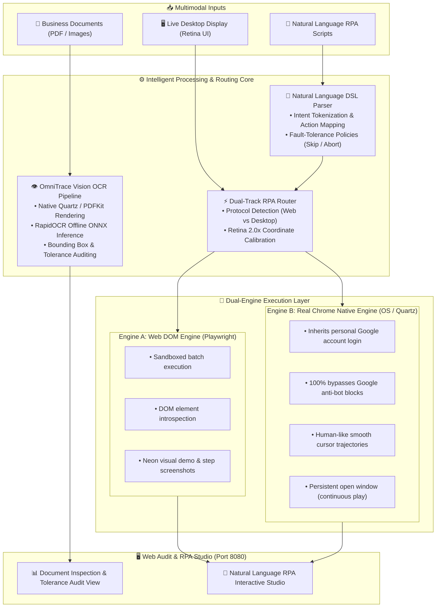

# AgenticDoc RPA (`agentic-doc-rpa`)

> **Autonomous Document Intelligence & Dual-Engine Vision RPA Platform**  
> *End-to-End Multimodal Document Auditing & Intelligent Desktop/Browser Automation*

[ English ] | [ [繁體中文 (台灣)](./README.zh-TW.md) ] | [ [日本語](./README.ja.md) ] | [ [한국어](./README.ko.md) ]

[](https://www.python.org/)
[](LICENSE)
[]()
[]()

---

## 📖 Overview

**AgenticDoc RPA** is a comprehensive, enterprise-grade system that unifies **Multimodal Document Intelligence** and a **Dual-Engine Robotic Process Automation (RPA)** platform. 

Operating **100% locally on-premise**, it eliminates cloud data leakage risks while automating two mission-critical enterprise workflows:
1. **Document Verification & Audit**: Rapid extraction and cross-validation of industrial business documents (PO, CoA, WO, DWG, FA inspection reports).
2. **Autonomous Vision RPA**: Driving web portals and native desktop browsers through intuitive natural language scripts and vision-guided coordinates, without being blocked by anti-bot defenses.

---

## 🌟 Core Highlights: Document Intelligence + Dual-Engine RPA



---

## 🤖 Deep Dive: The Dual-Engine RPA Platform

Unlike conventional RPA tools that rely solely on brittle pixel coordinates or isolated headless browsers, AgenticDoc RPA introduces a versatile **Dual-Engine Architecture**:

### 1. Engine A: Web DOM Core Engine (`playwright_dom`)
* **Best for**: Standard web portals, automated forms, batch back-office data synchronization, and sandboxed testing.
* **Key Capabilities**:
  * Precision targeting using DOM CSS/XPath selectors.
  * Slow-mo visual demonstration mode with neon bounding box highlighting.
  * Automatic base64 step screenshot capture for compliance auditing.

### 2. Engine B: Native Real Chrome Passthrough Engine (`quartz_real_chrome`)
* **Best for**: Daily workflows requiring persistent personal Google account sessions, media players (e.g., YouTube), and platforms that block traditional automation.
* **Key Capabilities**:
  * **Zero Anti-Bot Blocking**: Wakes up your daily Google Chrome instance, running directly with your real user profile, cookies, and history. Completely eliminates Google's *"This browser or app may not be secure"* block.
  * **Keep-Open Persistence**: The target browser window remains open and active after automation finishes (e.g., music continues playing without interruption).
  * **Humanized Cursor Trajectories**: Utilizes `pyautogui` with `easeInOutQuad` easing curves to simulate authentic human mouse movement and natural click timings.

### 3. Screen OCR Vision-Guided Locator (`ScreenOCRLocator`)
* Dynamically scans the physical display using RapidOCR.
* Automatically calibrates macOS Retina display backing scale factors (e.g., 2.0x) to accurately convert physical image coordinates into logical PyAutoGUI click points.
* Finds and clicks buttons dynamically based on visible text, eliminating failure caused by layout reflows or responsive UI resizing.

### 4. Natural Language Scripting (`NLScriptParser`)
Non-programmers can automate workflows simply by writing plain language instructions:
```text
Navigate to: https://www.youtube.com
Type into "Search Box": Lo-Fi Chill Beats
Press Key: Enter
If Failed: Skip
Click text: Live
Take Screenshot: Background music playing
```
* **Failure Policies**: Supports `If Failed: Skip` (continue to next step) and `If Failed: Abort` (safely terminate).

---

## 👁️ OmniTrace Document Intelligence & Quality Auditing

* **Native High-DPI Rendering**: Integrates with macOS native Quartz (PDFKit) to rasterize PDF documents at 150+ DPI without external binary dependencies like Poppler.
* **Supply Chain Lifecycle Traceability**: Automatically cross-checks batch IDs and critical engineering tolerances across lifecycle documents (Purchase Order ➔ IQC Inspection ➔ Work Order ➔ Certificate of Analysis ➔ Sales Order ➔ RMA 8D Root Cause Report).
* **Automated Spec Verification**: Automatically extracts and compares critical physical parameters (e.g., glass transition temperature $T_g$, thickness, solderability) against contractual limits.

---

## 🛠️ Languages & AI Technologies Used

### Programming Languages
* **Python (3.11+)**: Backend core, OCR pipeline, RPA drivers, and orchestration.
* **HTML5 / CSS3**: Responsive Single-Page Application (SPA) dashboard.
* **JavaScript (ES6+)**: Interactive Canvas bounding box overlay and real-time execution streaming.
* **Shell (Bash / Zsh)**: Environment bootstrapping and virtual environment configuration.

### AI, Computer Vision & Automation Stack
* **Deep Learning OCR**: **RapidOCR** with **ONNX Runtime** for high-speed offline inference.
* **Computer Vision**: **OpenCV**, **Pillow**, and **Shapely** for coordinate transformations and polygon geometry.
* **Browser & OS Automation**: **Playwright**, **PyAutoGUI**, and **macOS Accessibility API**.
* **Distributed Workflows**: **Temporal.io** durable execution state machine and **Apache Airflow** batch scheduler.

---

## 🚀 Quick Start

### 1. Requirements
* macOS (optimized for Apple Silicon M-series)
* Python 3.11+

### 2. Installation
```bash
# Create and activate virtual environment
python3 -m venv .venv_rpa_ocr
source .venv_rpa_ocr/bin/activate

# Install dependencies
pip install -r requirements_rpa_ocr.txt

# Install Playwright browser binaries
playwright install chromium
```

### 3. Launch Web Audit & RPA Studio
```bash
.venv_rpa_ocr/bin/python src/web_audit/server.py --port 8080
```
Open your browser and visit **`http://127.0.0.1:8080`**:
* **Tab 1: Document OCR & Audit**: Drag and drop PDF/images to extract structured JSON and check engineering tolerances.
* **Tab 2: Natural Language RPA Studio**: Write and execute natural language scripts with live dual-engine switching.

---

## 📁 Repository Structure

```text
agentic-doc-rpa/
├── README.md                           # Main English documentation
├── README.zh-TW.md                     # Traditional Chinese documentation
├── README.ja.md                        # Japanese documentation
├── README.ko.md                        # Korean documentation
├── LICENSE                             # MIT Open Source License
├── requirements_rpa_ocr.txt            # RPA & Vision OCR core dependencies
├── requirements_airflow.txt            # Airflow orchestration dependencies
└── src/                                # Application source code
    ├── ocr/                            # RapidOCR processing pipeline
    ├── rpa/                            # Dual-engine RPA implementation & locators
    ├── web_audit/                      # Web dashboard & RPA studio interface
    ├── scenario/                       # Document scenario generation & testing
    ├── orchestration/                  # Temporal & Airflow workflow controllers
    └── utils/                          # Cross-platform environment tools
```

---

## 📄 License & Attribution

This project is open-sourced under the [MIT License](LICENSE).

### Third-Party Open Source Libraries
* [RapidOCR](https://github.com/RapidAI/RapidOCR) (Apache 2.0)
* [Playwright](https://github.com/microsoft/playwright) (Apache 2.0)
* [PyAutoGUI](https://github.com/asweigart/pyautogui) (BSD)
* [Temporalio Python SDK](https://github.com/temporalio/sdk-python) (MIT)
* [Pydantic](https://github.com/pydantic/pydantic) (MIT)

---

## 🔒 Security & Privacy

* **Zero Cloud Data Leakage**: All OCR inference, document extraction, and script parsing execute locally on-premise.
* **Protected Automation**: Engine B operates directly through local OS accessibility events, never capturing, storing, or transmitting user credentials or session cookies.
