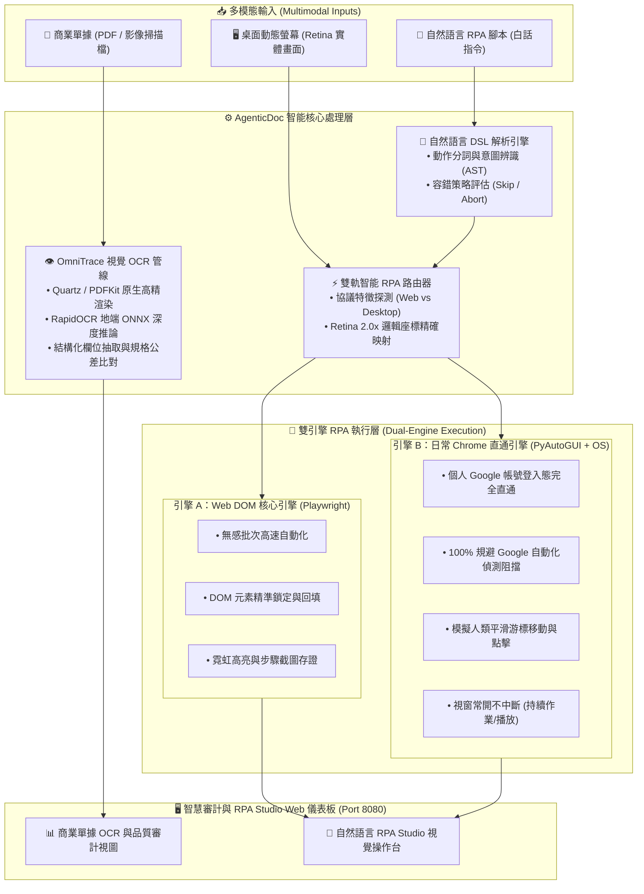

# AgenticDoc RPA (`agentic-doc-rpa`)

> **智能單據代理與雙引擎視覺 RPA 系統**  
> *Autonomous Document Intelligence & Dual-Engine Vision RPA Platform*

[ [English](./README.md) ] | [ 繁體中文 (台灣) ] | [ [日本語](./README.ja.md) ] | [ [한국어](./README.ko.md) ]

[](https://www.python.org/)
[](LICENSE)
[]()
[]()

---

## 📖 專案簡介 (Overview)

**AgenticDoc RPA** 是一套專為企業級商業單據生命週期審計、跨系統供應鏈追溯與現代化桌面/網頁自動化設計的**智能單據代理與雙引擎視覺 RPA 系統**。

本系統全程具備 **100% 地端原生運作 (On-Premise Ready)** 能力，免除機敏商業機密與財務單據上傳雲端之外洩風險。系統深度整合「多模態單據視覺審計」與「現代化雙軌 RPA」兩大核心支柱：
1. **單據審計與供應鏈追溯**：高速抽取並校驗複雜商業單據（PO 採購單、CoA 檢驗證明、工單、DWG 工程圖面、FA 8D 失效分析報告）。
2. **自主雙引擎視覺 RPA**：支援白話自然語言指令與動態視覺 OCR 座標定位，無需編寫程式碼即可驅動 Web 與日常桌面瀏覽器，且完全規避 Google 等反爬蟲與機器人偵測阻擋。

---

## 🌟 核心特色：單據審計 + 雙引擎 RPA 架構圖



---

## 🤖 核心亮點：雙引擎 RPA 自動化平台深度解析

傳統 RPA 工具往往依賴脆弱的固定像素座標，或受限於孤立的無頭瀏覽器（Headless），經常遭遇反自動化防護封鎖或在不同螢幕解析度下點擊落空。AgenticDoc RPA 針對不同業務情境，提供專屬的**雙軌執行架構**：

### 1. 引擎 A：Web DOM 核心引擎 (`playwright_dom`)
* **適用場景**：標準企業內部網站、表單批次資料自動化回填、大量報表無感後台拋轉。
* **特色功能**：
  * **DOM 語意定位**：支援 CSS Selector、XPath 與文字錨點，抗版面流動能力強。
  * **視覺回饋與演示**：內建 Slow-mo 慢速示範模式與霓虹外框即時高亮。
  * **法規存證快照**：自動為每一執行步驟產生 Base64 截圖，便於審計追溯。

### 2. 引擎 B：日常 Chrome 直通引擎 (`quartz_real_chrome`)
* **適用場景**：需要使用者個人 Google 登入狀態、書籤設定之雲端平台（如 YouTube、個人 Google Workspace），以及具備嚴格反自動化偵測的外部系統。
* **特色功能**：
  * **100% 規避 Google 自動化阻擋**：直接喚醒您本機日常使用的 Google Chrome 實例，繼承現有帳號登入態與 Cookie，徹底告別 Google 的 *"This browser or app may not be secure"* 攔截。
  * **視窗常開不中斷 (Keep-Open)**：自動化任務完成後視窗持續保持開啟（例如 YouTube 音樂持續在背景播放，陪伴專注工作，絕不強制關閉）。
  * **人為平滑游標軌跡**：透過 `pyautogui` 與 `easeInOutQuad` 貝茲緩動曲線，以人類自然速度移動滑鼠並點擊，完美規避行為分析型反爬蟲。

### 3. 螢幕視覺 OCR 座標定位器 (`ScreenOCRLocator`)
* 即時截取全螢幕或視窗畫面，調用 RapidOCR 引擎辨識畫面文字。
* 自動偵測並校準 macOS Retina 螢幕解析度倍率（如 2.0x 邏輯縮放），將物理影像像素精確換算為作業系統邏輯點座標。
* 依據「文字內容」即時鎖定按鈕中心，不依賴固定座標，無懼視窗縮放或畫面排版微調。

### 4. 自然語言 RPA 腳本引擎 (`NLScriptParser`)
業務人員或非工程師可直接使用白話中文指令編寫自動化腳本：
```text
前往網址: https://www.youtube.com
在「搜尋框」輸入: 讀書長音樂
按下鍵盤: Enter
如果失敗: 跳過
點擊包含文字: 讀書
等待 2 秒
截圖說明: 背景音樂播放中
```
* **容錯策略**：支援 `如果失敗: 跳過 (skip)` 與 `如果失敗: 中斷 (abort)`，大幅降低自動化偶發中斷率。

---

## 👁️ OmniTrace 商業單據視覺審計功能

* **原生高解析度渲染**：深度整合 macOS 原生 Quartz (PDFKit) 圖形子系統，以 150+ DPI 高解析度原生光柵化 PDF 單據，擺脫 Poppler 等外部龐大依賴。
* **供應鏈生命週期追溯**：針對半導體與高科技製造業生命週期（採購單 PO ➔ 收貨 IQC ➔ 工單 WO ➔ 檢驗證明 CoA ➔ 銷貨出貨 SO ➔ RMA 8D 失效分析報告），提供跨單據批號關聯與數值一致性稽核。
* **規格公差自動化比對**：自動比對關鍵物性參數（如玻璃轉移溫度 $T_g$ 規格上限/下限 vs 實測值、厚度、抗拉強度等），即時標記超標警示。

---

## 🛠️ 程式語言與 AI 技術宣告 (Tech Stack & AI)

### 程式與腳本語言 (Languages)
* **Python (3.11+)**：系統核心後端、工作流編排、單據特徵抽取與自動化驅動。
* **HTML5 / CSS3**：響應式單頁應用 (SPA)，提供即時審計視覺化與 RPA 操作台。
* **JavaScript (ES6+)**：前端動態欄位呈現、Canvas 外框繪製與即時狀態輪詢。
* **Shell (Bash / Zsh)**：環境自動化引導與虛擬環境路徑校正工具。

### AI、電腦視覺與自動化技術宣告 (AI & Vision Stack)
* **深度學習視覺 OCR 推論**：採用 **RapidOCR** 核心配合 **ONNX Runtime** 加速引擎，提供全地端、高精度的多語系印刷與表格文字識別。
* **幾何空間與座標校準**：使用 **Shapely** 與 **OpenCV** 進行邊界框（Bounding Box）關聯分析與 Retina 縮放校準。
* **雙引擎 RPA 架構**：整合 **Playwright** 瀏覽器自動化核心與 **PyAutoGUI** 作業系統底層事件模擬。
* **分散式持久化狀態機**：整合 **Temporal.io** 耐久工作流程與 **Apache Airflow** 宏觀排程切批。

---

## 🚀 快速上手 (Quick Start)

### 1. 環境準備
* **作業系統**：macOS (推薦 Apple Silicon M 系列晶片)
* **Python 版本**：Python 3.11+

### 2. 安裝相依套件
```bash
# 建立並啟用虛擬環境
python3 -m venv .venv_rpa_ocr
source .venv_rpa_ocr/bin/activate

# 安裝核心依賴
pip install -r requirements_rpa_ocr.txt

# 安裝 Playwright 瀏覽器核心
playwright install chromium
```

### 3. 啟動 Web 審計與 RPA Studio
```bash
.venv_rpa_ocr/bin/python src/web_audit/server.py --port 8080
```
開啟瀏覽器訪問：**`http://127.0.0.1:8080`** 即可體驗：
* 📄 **分頁 1：商業單據 OCR 與品質審計**：支援拖曳上傳單據，即時抽取結構化 JSON 與欄位公差校驗。
* 🤖 **分頁 2：自然語言 RPA Studio**：以白話指令執行雙引擎自動化流程，提供即時步驟進度與高亮視覺截圖。

---

## 📁 目錄結構說明 (Directory Layout)

```text
agentic-doc-rpa/
├── README.md                           # 英文主說明文件
├── README.zh-TW.md                     # 台灣繁體中文說明文件
├── README.ja.md                        # 日文說明文件
├── README.ko.md                        # 韓文說明文件
├── LICENSE                             # MIT 開源授權協議
├── requirements_rpa_ocr.txt            # RPA 與視覺 OCR 核心相依套件清冊
├── requirements_airflow.txt            # 宏觀排程相依套件清冊
└── src/                                # 核心原始碼
    ├── ocr/                            # RapidOCR 視覺抽取管線
    ├── rpa/                            # 雙引擎 RPA 實作與定位器
    ├── web_audit/                      # 智慧審計與 RPA Studio Web 介面
    ├── scenario/                       # 單據情境與測試驗證資料
    ├── orchestration/                  # Temporal 與 Airflow 編排控制器
    └── utils/                          # 通用工具與環境修復腳本
```

---

## 📄 授權協議宣告 (License)

本專案採用 **[MIT License](LICENSE)** 授權協議開放原始碼。

### 第三方開源套件聲明
* [RapidOCR](https://github.com/RapidAI/RapidOCR) (Apache 2.0)
* [Playwright](https://github.com/microsoft/playwright) (Apache 2.0)
* [PyAutoGUI](https://github.com/asweigart/pyautogui) (BSD)
* [Temporalio Python SDK](https://github.com/temporalio/sdk-python) (MIT)
* [Pydantic](https://github.com/pydantic/pydantic) (MIT)

---

## 🔒 資訊安全與隱私宣告 (Security & Privacy)

* **數據不出地端**：全流程 AI 推論與視覺辨識皆在本地記憶體與處理器運行，敏感單據絕不外流。
* **真實帳號安全直通**：引擎 B 透過本機作業系統輔助事件直接控制日常 Chrome，完全不讀取、不儲存亦不上傳使用者的密碼或 Session Cookie。
